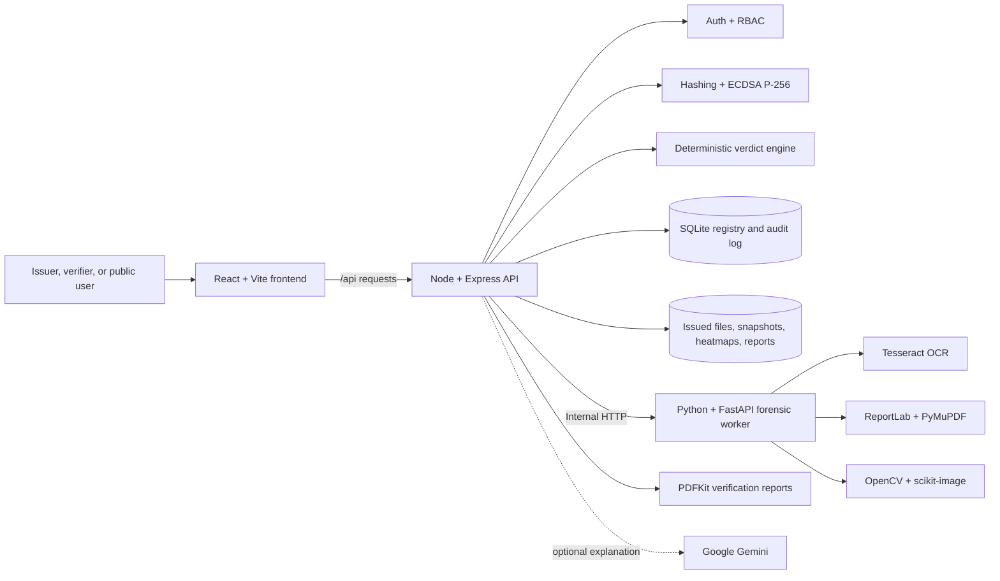
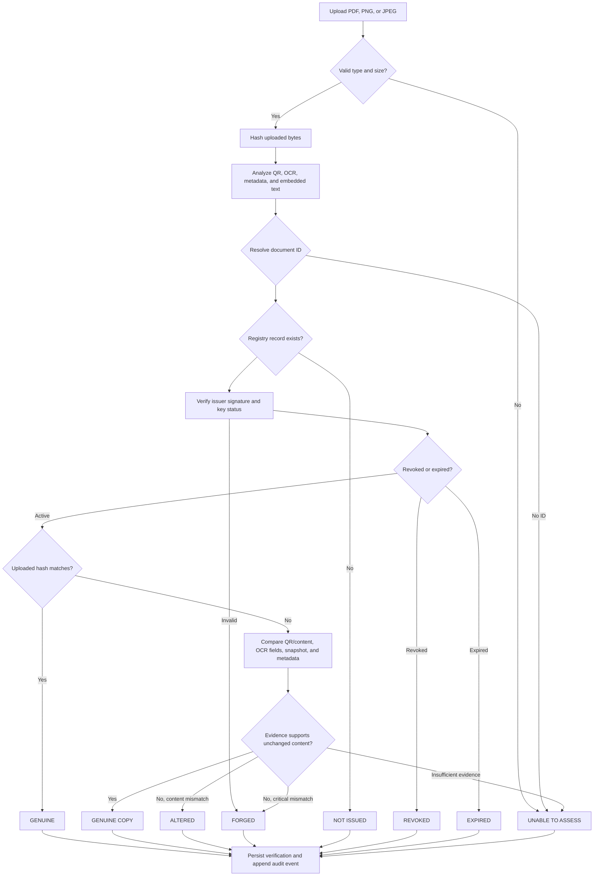
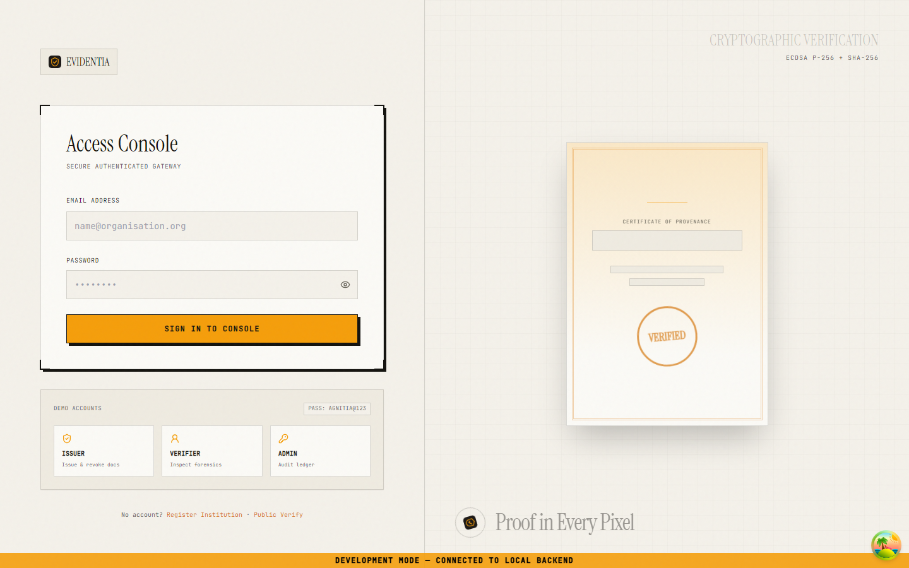
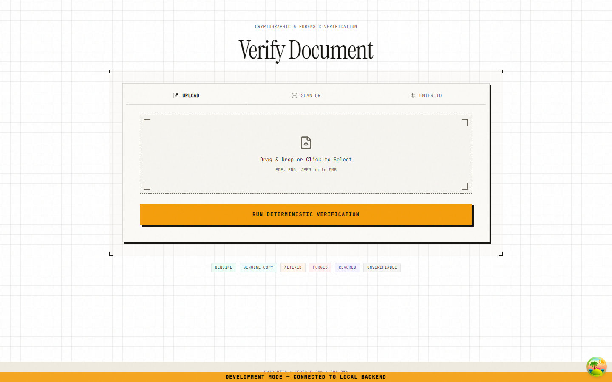

<div align="center">

# Evidentia

### Proof in every pixel.

**A secure digital document verification platform for issuing, inspecting, and validating signed documents.**

Evidentia combines issuer signatures, registry lookups, QR extraction, OCR, metadata inspection, and visual comparison to explain whether a document is genuine, copied, altered, forged, revoked, expired, or impossible to assess.

[](LICENSE)
[](https://nodejs.org/)
[](https://react.dev/)
[](https://www.python.org/)
[](https://fastapi.tiangolo.com/)

</div>

> **Prototype status:** Evidentia is an automated verification aid, not a legal certificate of authenticity. Its evaluation uses synthetic, template-controlled documents; production deployments need stronger key custody, external audit anchoring, and broader real-world validation.

---

## Contents

- [Why Evidentia](#why-evidentia)
- [What it can decide](#what-it-can-decide)
- [Features](#features)
- [Technology stack](#technology-stack)
- [Architecture](#architecture)
- [Verification flow](#verification-flow)
- [Screenshots](#screenshots)
- [Project structure](#project-structure)
- [Quick start](#quick-start)
- [Configuration](#configuration)
- [Usage](#usage)
- [API overview](#api-overview)
- [Testing and evaluation](#testing-and-evaluation)
- [Deployment](#deployment)
- [Roadmap](#roadmap)
- [Contributing](#contributing)
- [License and acknowledgments](#license-and-acknowledgments)
- [Limitations](#limitations)

## Why Evidentia

Documents are often checked by looking at a logo, a QR code, or a PDF preview. Those signals are useful, but none proves that the file is the one an issuer created. Evidentia separates the trust questions:

- **Was the registry record signed by a trusted issuer key?**
- **Is this file byte-for-byte identical to the issued file?**
- **If the bytes changed, do the readable fields and visual evidence still match?**
- **Is the document still active, or has it been revoked or expired?**

The verdict is composed by deterministic cryptography and rules. Optional AI-assisted wording can explain an already-computed result, but it does not decide the verdict.

## What it can decide

| Verdict | Meaning |
| --- | --- |
| `GENUINE` | The uploaded bytes exactly match the issuer's recorded file hash. |
| `GENUINE COPY` | The bytes differ, but readable content and visual evidence remain consistent with the issued document. |
| `ALTERED` | A registered document contains changed or missing content. |
| `FORGED` | The signature is invalid, or a genuine QR identifies a document whose content was rebuilt. |
| `NOT ISSUED` | The document ID is not present in the registry. |
| `UNVERIFIABLE` | The issuer or key cannot currently be trusted; this is not the same as “fake”. |
| `REVOKED` / `EXPIRED` | The issuer withdrew the document, or its validity window ended. |
| `UNABLE TO ASSESS` | There is not enough readable evidence to reach a reliable conclusion. |

Confidence is qualitative—`High`, `Medium`, or `Low`—and is not a probability.

## Features

### For issuers

- ✍️ Issue signed certificates with deterministic PDF rendering and an embedded verification QR.
- 📦 Issue documents individually or in bulk from spreadsheet templates.
- 🎨 Manage issuer branding, templates, backgrounds, and signatory assets.
- 📚 Browse issued documents, download reports, and revoke documents.
- 📊 View issuer dashboards and verification reports.

### For verifiers and the public

- 🔎 Verify a PDF, PNG, or JPEG with optional authentication.
- 📷 Extract a document ID from a QR code.
- 🧾 Compare hashes, signatures, OCR fields, metadata, and rendered snapshots.
- 🟥 View visual-difference heatmaps for suspected changes.
- 🌐 Open a privacy-limited public verification page without an account.

### For administrators and operators

- 🔐 Role-based access for administrators, issuers, and verifiers.
- 🧱 Hash-chained audit events with an integrity check endpoint.
- 🩺 Health checks for the API and forensic services.
- 🛡️ Upload validation, rate limiting, Helmet security headers, path checks, and sanitized extracted text.

## Technology stack

| Area | Technologies | Responsibility |
| --- | --- | --- |
| Web application | [React 18](https://react.dev/), [React Router](https://reactrouter.com/), [Vite](https://vite.dev/), [Tailwind CSS](https://tailwindcss.com/) | Responsive issuer, verifier, public, and admin experiences |
| UI behavior | [Framer Motion](https://motion.dev/), [GSAP](https://gsap.com/), [Lucide](https://lucide.dev/), Radix UI | Animation, icons, accessible primitives, and interaction patterns |
| API and registry | [Node.js 20+](https://nodejs.org/), [Express](https://expressjs.com/), [better-sqlite3](https://github.com/WiseLibs/better-sqlite3) | Authentication, persistence, issue orchestration, verdict composition, audit, and reports |
| Cryptography | Node `crypto`, ECDSA P-256, SHA-256, [bcryptjs](https://github.com/dcodeIO/bcrypt.js), [jsonwebtoken](https://github.com/auth0/node-jsonwebtoken) | Issuer signatures, password hashing, JWT sessions, and content hashes |
| Forensics service | [Python](https://www.python.org/), [FastAPI](https://fastapi.tiangolo.com/), [Uvicorn](https://www.uvicorn.org/) | Rendering, OCR, QR extraction, metadata inspection, and image comparison |
| Document processing | [ReportLab](https://www.reportlab.com/), [PyMuPDF](https://pymupdf.readthedocs.io/), [Tesseract](https://github.com/tesseract-ocr/tesseract), [OpenCV](https://opencv.org/), scikit-image, Pillow | PDF generation, rasterization, OCR, QR decoding, and heatmaps |
| Optional AI | [Google Gemini](https://ai.google.dev/) | Explanation text only; never the verdict engine |
| Quality and delivery | Node test runner, Python scripts, Docker Compose, Vercel configuration | Tests, evaluation set generation, and container/deployment support |

## Architecture

The default local profile uses Node as the public API and Python as an internal forensic worker. The browser never calls the Python service directly.



**Trust boundary:** Node owns users, issuer keys, registry records, verdict rules, and audit entries. Python receives files for analysis but has no private-key access, no registry authority, and no verdict authority.

### Core components

| Component | Location | Responsibility |
| --- | --- | --- |
| Frontend | `frontend-react/` | Landing page, authentication, issuer workspace, verification UI, public pages, and admin audit UI |
| Node API | `backend-node/` | Sessions, issuer workflows, registry, cryptography, verdict engine, reports, audit, and API security |
| Python services | `worker-python/` | Certificate rendering, PDF/image analysis, QR extraction, OCR, metadata, and visual diffing |
| Local data | `backend-node/agnitia.db`, `backend-node/storage/`, `keys/` | SQLite records, generated artifacts, and git-ignored issuer private keys |

## Verification flow



The issue flow avoids a QR/hash circularity: the QR contains the public verification URL, the final PDF is rendered, then the final bytes are hashed and signed in the registry.

## Screenshots

The repository includes responsive audit captures from the application:

<p align="center">
  
  
</p>

Additional desktop, tablet, and mobile captures are available in [`docs/audit-shots/`](docs/audit-shots/).

## Project structure

```text
.
├── backend-node/
│   ├── src/
│   │   ├── routes/          API route handlers
│   │   ├── services/        Auth, crypto, issue, verification, verdict, audit, reports
│   │   └── db.js            SQLite schema and database access
│   ├── tests/               Node-specific tests, including optional AI/semantic checks
│   ├── .env.example         Local Node configuration template
│   └── package.json         API scripts and dependencies
├── frontend-react/
│   ├── src/pages/           Landing, auth, issuer, verifier, public, and admin screens
│   ├── src/components/      Shared UI and application states
│   ├── public/              Public sample downloads
│   ├── .env.example         Vite configuration template
│   └── package.json         Frontend scripts and dependencies
├── worker-python/
│   ├── services/             PDF, OCR, QR, metadata, template, and diff services
│   ├── routers_*.py          FastAPI route modules
│   ├── main.py               FastAPI entry point
│   └── requirements.txt      Python dependencies
├── scripts/                  Key generation, database initialization, and demo seeding
├── tests/                    Crypto, verdict, integration, and tamper-resistance tests
├── eval/                     Synthetic evaluation-set generation and scoring
├── samples/                  Genuine, altered, copied, forged, revoked, and unverifiable examples
├── docs/                     Architecture, API contract, audits, evaluation, and screenshots
├── docker-compose.yml        Container deployment profile
└── LICENSE                   MIT license
```

## Quick start

### Prerequisites

- Node.js **20 or newer**
- Python **3.11** with `pip` (the repository pins `3.11.9` in `.python-version`)
- Tesseract OCR (`tesseract-ocr` on Debian/Ubuntu or `brew install tesseract` on macOS)
- Git

### 1. Install dependencies

```bash
git clone https://github.com/Santoshray-27/document-verification-v1.git
cd document-verification-v1

npm --prefix backend-node install
npm --prefix frontend-react install
python3 -m pip install -r worker-python/requirements.txt
```

### 2. Configure and initialize the local registry

```bash
cp backend-node/.env.example backend-node/.env
node scripts/generate-keys.js
node scripts/init-db.js
node scripts/seed-demo.js
```

The initialization scripts create the local SQLite schema, generate an issuer key pair under the git-ignored `keys/` directory, and seed demo users. Use a unique `JWT_SECRET` and `DEMO_PASSWORD` outside local demonstrations.

### 3. Start the services

Run each service in its own terminal:

```bash
# Terminal 1: forensic worker
cd worker-python
python3 -m uvicorn main:app --host 127.0.0.1 --port 8001
```

```bash
# Terminal 2: Node API
npm --prefix backend-node start
```

```bash
# Terminal 3: React development server
npm --prefix frontend-react run dev
```

Open [http://localhost:5173](http://localhost:5173). The Vite proxy forwards `/api` and `/static` to Node on port `4000`.

For a single-origin local demo, build the frontend and let Node serve `frontend-react/dist`:

```bash
npm --prefix frontend-react run build
npm --prefix backend-node start
```

### Demo accounts

All seeded accounts use the value of `DEMO_PASSWORD` (the example defaults to a development-only password):

| Role | Email | Capabilities |
| --- | --- | --- |
| Issuer | `issuer@agnitia.io` | Issue, list, bulk-issue, and revoke documents |
| Verifier | `verifier@agnitia.io` | Verify documents |
| Admin | `admin@agnitia.io` | Review audit events, check integrity, and onboard issuers |

Public verification does not require an account.

### Phone QR scanning

QR codes embed `PUBLIC_BASE_URL`. For phone testing, set it to a reachable HTTPS tunnel before issuing documents:

```bash
ngrok http 4000
# Set PUBLIC_BASE_URL=https://your-tunnel.example in backend-node/.env
# Restart Node and issue a new document.
```

Previously issued documents retain the URL embedded at issuance time.

## Configuration

Copy the relevant example file before starting a service. Never commit `.env` files, private keys, database files, or generated storage artifacts.

### Node API: `backend-node/.env`

| Variable | Default | Purpose |
| --- | --- | --- |
| `PORT` | `4000` | Public Node API port |
| `NODE_ENV` | `development` | Runtime environment |
| `DB_PATH` | `./agnitia.db` | Local SQLite path |
| `JWT_SECRET` | development placeholder | JWT signing secret; replace outside local demos |
| `JWT_EXPIRES_IN` | `12h` | Session lifetime |
| `KEYS_DIR` | `../keys` | Issuer private/public key directory |
| `STORAGE_DIR` | `./storage` | Generated files and analysis artifacts |
| `PYTHON_WORKER_URL` | `http://127.0.0.1:8001` | Internal Python service URL |
| `WORKER_TIMEOUT_MS` | `20000` | Internal worker request timeout |
| `PUBLIC_BASE_URL` | `http://localhost:5173` | Base URL embedded in QR codes |
| `ALLOWED_ORIGINS` | local Vite origins | Explicit CORS origins |
| `MAX_UPLOAD_MB` | `5` | Upload size limit |
| `RATE_LIMIT_PUBLIC_WINDOW_MS` | `600000` | Public rate-limit window |
| `RATE_LIMIT_PUBLIC_MAX` | `30` | Public requests per window and IP |
| `RATE_LIMIT_DISABLED` | `false` | Test-only limiter bypass |
| `DEMO_PASSWORD` | development placeholder | Seeded demo account password |

`DATABASE_URL` and `USE_SUPABASE` are also recognized by the Node configuration for the optional PostgreSQL/Supabase path. The default local profile uses SQLite.

### Frontend: `frontend-react/.env.example`

| Variable | Default | Purpose |
| --- | --- | --- |
| `VITE_API_BASE_URL` | `/api` | API base path; same-origin is recommended |
| `VITE_SHOW_DEV_BANNER` | `true` | Shows the local development banner |

### Python service: `worker-python/.env.example`

| Variable | Purpose |
| --- | --- |
| `PORT` | Port used when launching `main.py` directly |
| `PUBLIC_BASE_URL` | Public base URL used by rendering-related flows |
| `STORAGE_DIR` | Shared storage location for generated artifacts |
| `KEYS_DIR` | Key directory setting for the unified deployment profile |
| `TESSERACT_CMD` | Optional absolute path to the Tesseract executable |
| `ALLOWED_ORIGINS` | Optional CORS configuration |
| `DATABASE_URL` | Database URL for the unified PostgreSQL-oriented profile |
| `JWT_SECRET` | JWT secret for the unified profile |
| `GEMINI_API_KEY` | Optional key for AI-assisted explanations |

## Usage

1. **Issue:** sign in as an issuer, enter certificate fields, render the document, and download the signed PDF.
2. **Verify:** open `/verify`, upload a file, and wait for the asynchronous verification job to finish.
3. **Inspect:** review the verdict, confidence, evidence checklist, field comparison, metadata signals, and heatmap when available.
4. **Share:** scan the QR code or open `/public/verify/:docId` for a limited public record.
5. **Manage:** use issuer document pages to download reports or revoke an issued document.
6. **Audit:** use `/admin/audit` to inspect the hash-chained event log and run its integrity check.

Sample inputs are available under [`samples/`](samples/), including altered documents, rasterized copies, forged examples, and revoked documents.

## API overview

Base URL: `http://localhost:4000/api`

| Method | Endpoint | Auth | Purpose |
| --- | --- | --- | --- |
| `POST` | `/auth/login` | None | Create a JWT session |
| `POST` | `/auth/register` | None | Register a user/issuer |
| `GET` | `/auth/me` | JWT | Return the current user |
| `POST` | `/issue/start` | Issuer | Start single-document issuance |
| `GET` | `/issue/jobs/:jobId` | Issuer | Poll issuance status |
| `GET` | `/issuer/documents` | Issuer | List issuer documents |
| `POST` | `/issuer/documents/:docId/revoke` | Issuer | Revoke a document |
| `POST` | `/issue/bulk/validate` | Issuer | Validate a spreadsheet |
| `POST` | `/issue/bulk/start` | Issuer | Start bulk issuance |
| `GET` | `/verify/jobs/:jobId/result` | Optional JWT | Read a verification result |
| `POST` | `/verify/start` | Optional JWT | Start PDF/image verification |
| `GET` | `/public/verify/:docId` | None | Read privacy-limited public metadata |
| `POST` | `/public/extract-qr` | None | Extract a document ID from an upload |
| `GET` | `/admin/audit` | Admin | Read audit events |
| `GET` | `/admin/audit/integrity` | Admin | Verify the audit hash chain |
| `GET` | `/reports/:verificationId` | Optional JWT | Download a verification report |
| `GET` | `/health` | None | Check API and worker health |

Authenticated requests use `Authorization: Bearer <token>`. Upload endpoints accept multipart form data with a `file` field and enforce the configured size limit.

For request bodies, response shapes, roles, and common errors, see [`docs/API_CONTRACT.md`](docs/API_CONTRACT.md). The Python service also exposes internal analysis endpoints such as `/render-certificate`, `/analyze`, `/diff-check`, and `/extract-qr`; these are not intended for direct browser use.

## Testing and evaluation

Run the configured checks from the repository root:

```bash
# Unit tests for cryptography and verdict composition
node --test tests/crypto.test.js tests/verdict.test.js

# End-to-end API assertions
node tests/e2e.js

# Broader configured Node test command
npm --prefix backend-node test

# Synthetic evaluation set
python3 eval/make_eval_set.py
node eval/run_eval.js
```

The latest recorded evaluation in [`docs/evaluation.md`](docs/evaluation.md) reports **40/40 correct**, **0 false alarms**, and **0 missed tampering cases** on the synthetic set. OCR field accuracy was **83.3%**, and average wall-clock verification was **6.6 seconds**, above the documented `<5 second` target. These results are not a claim of real-world accuracy.

The frontend provides `build` and `preview` scripts; no repository-level lint or formatting script is currently configured.

## Deployment

### Docker Compose

`docker-compose.yml` provides a container profile with a Python/FastAPI backend and an Nginx-served React frontend:

```bash
export DATABASE_URL='postgresql://<user>:<password>@<host>:<port>/<database>?sslmode=require'
export JWT_SECRET='<strong-secret>'
export PUBLIC_BASE_URL='https://your-public-host.example'
docker compose up --build
```

The frontend is exposed on port `5173` and the backend on port `4000` by default. Review the compose file and both Dockerfiles before production use; the compose profile is distinct from the default local split architecture.

### Production checklist

- Use an HSM/KMS instead of file-based private keys.
- Replace development JWT/demo credentials and configure explicit origins.
- Use managed PostgreSQL with backups and migrations appropriate to the deployment profile.
- Put the API behind TLS and a reverse proxy.
- Keep generated storage outside the image and back it up according to retention requirements.
- Anchor audit roots externally if tamper resistance must extend beyond database access.

No CI workflow is currently tracked in `.github/workflows/`; run the commands in [Testing and evaluation](#testing-and-evaluation) before publishing a build.

## Roadmap

The following are proposed improvements, not committed functionality:

- [ ] Move issuer private-key custody to an HSM/KMS.
- [ ] Add external anchoring for audit-chain roots.
- [ ] Improve OCR latency and field accuracy on real-world scans.
- [ ] Add automated CI for unit, end-to-end, and frontend build checks.
- [ ] Expand evaluation beyond synthetic, template-controlled documents.

## Contributing

Contributions are welcome:

1. Fork the repository and create a focused branch.
2. Keep changes scoped and avoid committing `.env` files, keys, databases, or generated artifacts.
3. Run the relevant tests and frontend build locally.
4. Update the documentation when behavior, routes, configuration, or setup changes.
5. Open a pull request describing the change, validation performed, and any security implications.

## License and acknowledgments

Evidentia is distributed under the [MIT License](LICENSE).

The project uses React, Express, FastAPI, ReportLab, PyMuPDF, Tesseract, OpenCV, scikit-image, Tailwind CSS, and other third-party packages under their respective licenses. See the package manifests for the complete dependency lists.

## Limitations

- Only registered issuers can be trusted by the local registry.
- Exact file hashes prove byte identity, not that the original document was truthful.
- `GENUINE COPY` is a heuristic based on OCR and visual similarity.
- Small edits that remain unreadable to OCR can be missed.
- Metadata is supporting evidence, not a decisive signal.
- Confidence labels are rule-based and not calibrated probabilities.
- The audit log is tamper-evident, not immutable.
- File-based keys are suitable for a prototype, not high-assurance production.
- The current evaluation uses synthetic documents and does not establish field performance.

For the detailed trust model and threat coverage, read [`docs/architecture.md`](docs/architecture.md) and [`docs/security-notes.md`](docs/security-notes.md).
